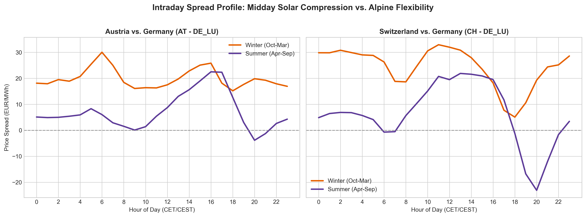
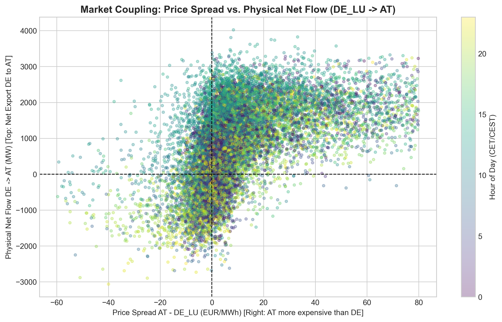

# DACH Power Market Spread & Flow Analyzer

An empirical data pipeline investigating Day-Ahead wholesale electricity market coupling, cross-border price divergence, and physical transfer flows across Germany/Luxembourg (**DE_LU**), Austria (**AT**), and Switzerland (**CH**) based on ENTSO-E market data (2025–2026).

---

## Key Empirical Findings

* **Structural Alpine Premium vs. Germany:** Both Austria and Switzerland trade at a significant structural premium to Germany. Austria's mean Day-Ahead price was **+12.85 €/MWh** above DE_LU (higher in **70.7%** of hours), while Switzerland traded at **+14.31 €/MWh** above DE_LU (higher in **67.9%** of hours).
* **Grid Congestion & Decoupling in Core FBMC:** Despite joint algorithmic clearing via Core Flow-Based Market Coupling (FBMC), full price convergence between Austria and Germany (< 0.50 €/MWh) occurred in only **4.1% of hours**, demonstrating persistent structural network constraints across the German-Austrian border.
* **Massive Negative Price Exposure:** Germany recorded **846 hours of negative prices** (dropping as low as **-372.41 €/MWh**), driven by renewable feed-in peaks. Alpine hydro flexibility and interconnectors provided significant dampening, reducing negative price occurrences to 580 hours in Austria and 542 hours in Switzerland.
* **Symmetric Alpine Equilibrium (AT vs. CH):** Despite Switzerland trading via explicit allocations outside SDAC, price formation between Austria and Switzerland remained remarkably balanced: a near-zero median spread of **+0.41 €/MWh** with an almost exact **50/50 hourly distribution** (CH > AT in 49.7% of hours).

---

## Market Statistics (2025–2026)

| Metric | Mean (€/MWh) | Median (€/MWh) | Std Dev (€/MWh) | Max Spread (€) | Min Spread (€) | Convergence <0.50€ (%) | Hours Zone1 > Zone2 (%) |
|---|---:|---:|---:|---:|---:|---:|---:|
| **Spread_AT_DE** | 12.85 | 5.61 | 27.52 | 232.09 | -291.50 | 4.1 | 70.7 |
| **Spread_CH_DE** | 14.31 | 6.18 | 34.20 | 230.00 | -377.92 | 3.9 | 67.9 |
| **Spread_CH_AT** | 1.46 | 0.41 | 23.08 | 146.41 | -349.02 | 3.9 | 49.7 |

### Negative Price Frequency
* **DE_LU:** 846 hours (Minimum: -372.41 €/MWh)
* **AT:** 580 hours (Minimum: -377.47 €/MWh)
* **CH:** 542 hours (Minimum: -463.68 €/MWh)

---

## Visualizations

### 1. Intraday Spread Profiles: Summer vs. Winter
Hourly spreads reveal midday price compression in Germany due to PV generation spikes, opening significant arbitrage windows for Alpine pumped-storage hydro facilities:



### 2. Market Coupling vs. Physical Reality (DE → AT)
Mapping Day-Ahead spreads against hourly physical net flows shows how loop flows and unscheduled wheeling transits cross the German-Austrian border even during adverse price signals:



---

## Repository Files

* `analyze_and_plot.py` – Calculates spread metrics and generates visualization plots.
* `process_local_data.py` – Ingestion, timezone harmonization, and Parquet data processing.
* `intraday_spreads.png` – Intraday hourly price profile comparison (Summer vs. Winter).
* `flows_vs_spread_at_de.png` – Day-Ahead price spread vs. physical net interconnector flows.
* `requirements.txt` – Core Python dependencies.
* `README.md` – Executive summary and empirical market findings.

---

## Methodology

1. **Ingestion & Filtering:** Parses wholesale Day-Ahead auction clearing prices (12.1.D) and physical cross-border flows (12.1.G) from ENTSO-E Transparency Platform extracts.
2. **Timezone Standardization:** Converts UTC timestamps to Central European Time (`Europe/Vienna` / CET/CEST) to align with actual delivery windows and clock-change intervals.
3. **Harmonization & Resampling:** Resamples mixed interval formats (15-min and 60-min TSO metering intervals) to consistent 1-hour time-weighted averages.
4. **Storage:** Compact storage via columnar Apache Parquet.

---

## Reproducibility

```bash
# Clone the repository
git clone [https://github.com/tobiellm/dach-power-spreads.git](https://github.com/tobiellm/dach-power-spreads.git)
cd dach-power-spreads

# Install dependencies
pip install -r requirements.txt

# Run pipeline
python process_local_data.py
python analyze_and_plot.py